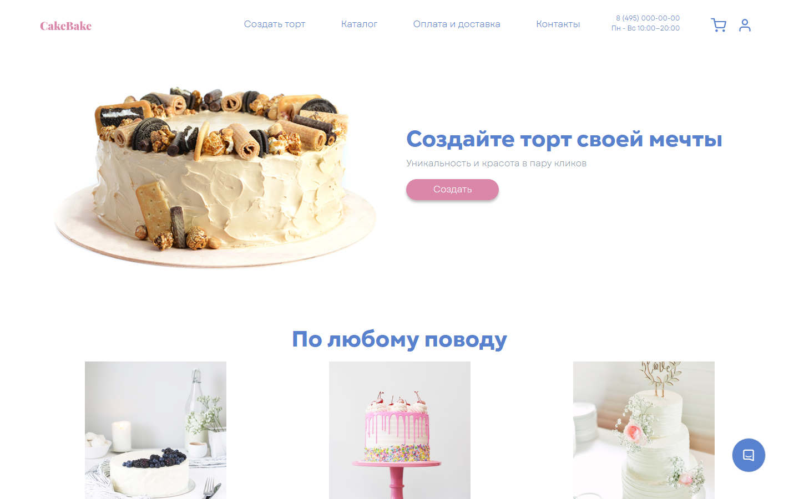
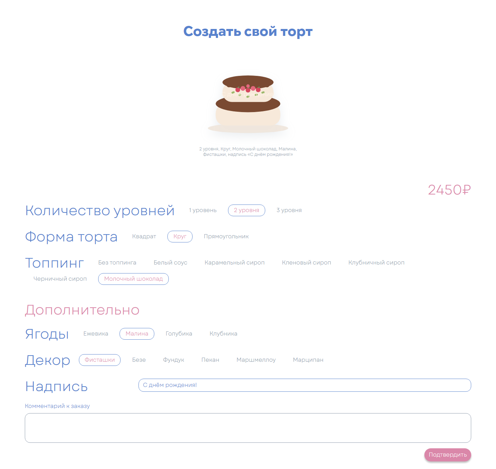
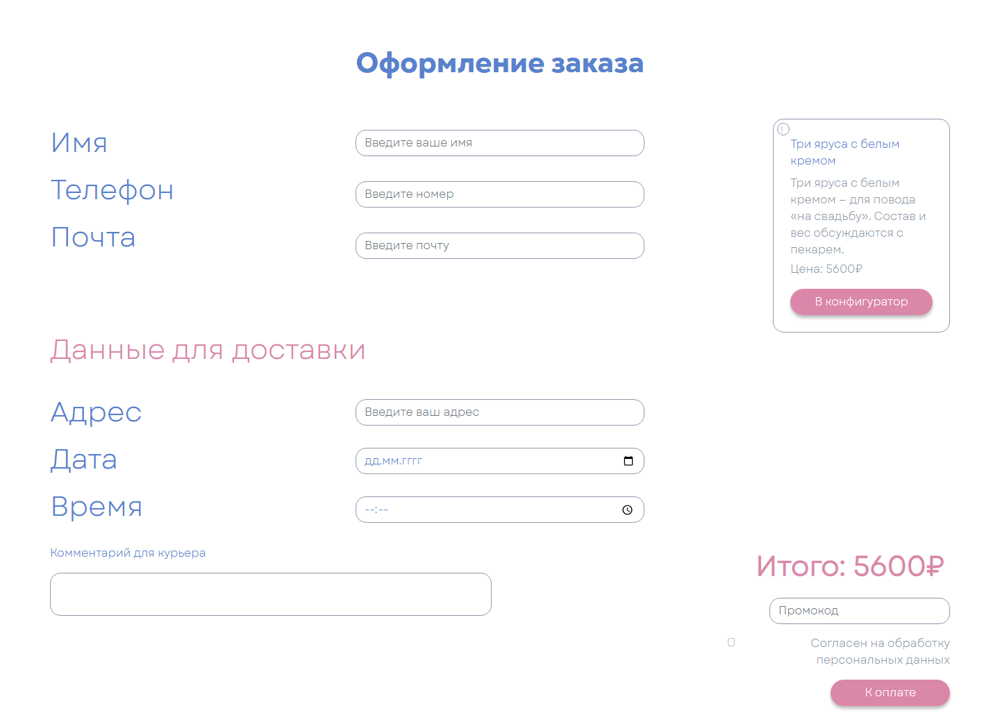
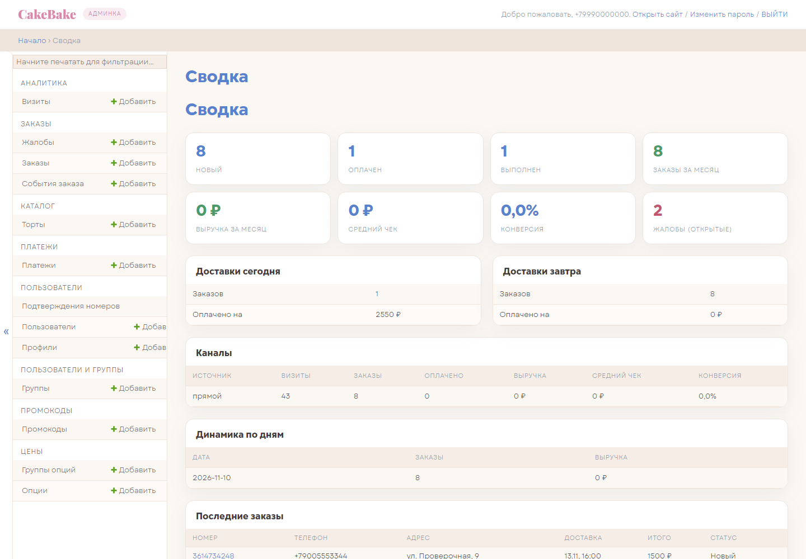
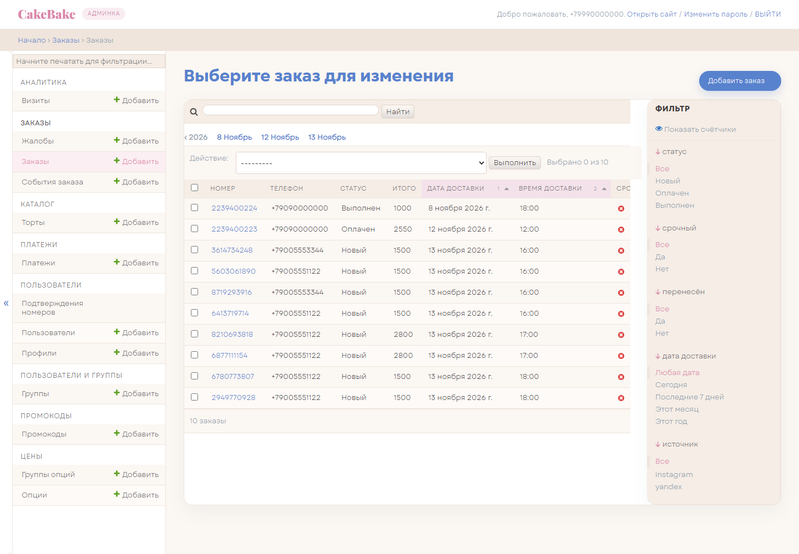

<div align="center">

# BakeCake

**Тортики на заказ: конструктор с живым предпросмотром, онлайн-оплата, личный кабинет и админка.**

[Демо-версия](https://bakecake.kislyakov.pro/) · [Админка](https://bakecake.kislyakov.pro/admin/) · [Инструкция для заказчика](docs/CLIENT_GUIDE.md)

[](https://github.com/skislyakow/BakeCake/actions/workflows/ci.yml)
[](https://www.python.org/)
[](https://www.djangoproject.com/)
[](https://www.django-rest-framework.org/)
[](https://www.sqlite.org/)
[](https://getbootstrap.com/)
[](https://vuejs.org/)
[](https://yookassa.ru/)
[](https://github.com/skislyakow/BakeCake/actions/workflows/ci.yml)
[](https://devman.org/)

<sub>Командный проект на курсе Devman</sub>

</div>

## О проекте

BakeCake закрывает весь путь заказа торта: посетитель выбирает готовый торт или
собирает свой, видит предпросмотр и цену, оформляет доставку, оплачивает заказ и
следит за ним в личном кабинете. Администратор получает заказ в тематической
админке, ведёт статусы и смотрит сводку по продажам и рекламным каналам.

Главная особенность — конструктор. Пять групп опций (ярусы, форма, топпинг,
ягоды, декор) собираются в SVG-предпросмотр, а стоимость считает сервер по ценам
из базы. В заказе сохраняется снимок состава и цен, поэтому история не меняется
вслед за прайсом.

## Как это выглядит

<p align="center">
  <a href="docs/screenshots/home.png"></a>
  <a href="docs/screenshots/configurator.png"></a>
</p>
<p align="center">
  <sub><b>Витрина</b> — готовые торты, поводы и преимущества &nbsp;·&nbsp; <b>Конструктор</b> — сборка торта с живым предпросмотром и ценой</sub>
</p>

<p align="center">
  <a href="docs/screenshots/checkout.png"></a>
  <a href="docs/screenshots/admin-dashboard.png"></a>
</p>
<p align="center">
  <sub><b>Оформление</b> — доставка, контакты и оплата &nbsp;·&nbsp; <b>Сводка</b> — заказы, выручка, конверсия и каналы</sub>
</p>

<p align="center">
  <a href="docs/screenshots/admin-orders.png"></a>
</p>
<p align="center">
  <sub><b>Заказы в админке</b> — статусы, суммы и быстрый переход к составу заказа</sub>
</p>

## Возможности

### Конструктор торта

- Пять групп опций: количество ярусов, форма, топпинг, ягоды и декор.
- SVG-предпросмотр собирается из выбранных ярусов, цветов, ягод, декора и надписи.
- Цена пересчитывается на сервере по актуальным ценам из БД, а не на клиенте.
- Срочный заказ с надбавкой 20 %, окно доставки 10:00–23:00 и запас на изготовление 24 часа.
- Надпись на торте и комментарий к заказу.
- «Повторить заказ» восстанавливает состав из истории, ссылка `?cake=<id>` открывает готовый торт в оформлении.

### Каталог и оформление

- Каталог готовых тортов с поводами: чаепитие, день рождения, свадьба.
- Форма заказа: имя, телефон, почта, адрес, дата и время доставки, комментарий.
- Проверка полей на клиенте и повторная проверка на сервере.
- Промокоды и скидки, единый номер заказа и журнал событий.
- Согласие на обработку персональных данных фиксируется с датой, IP и версией документа.

### Оплата и личный кабинет

- Оплата через ЮKassa: редирект на страницу оплаты и обработка вебхука.
- Идемпотентность платежей и статусы `pending`, `succeeded`, `canceled`.
- Статусы заказа `new`, `paid`, `delivered` и история изменений.
- Вход по номеру телефона: демо-режим, отключённый режим или подтверждение через Звонок.
- Профиль, адрес по умолчанию, история заказов, повтор заказа и жалоба по заказу.

### Админка и аналитика

- Тематическая админка в палитре сайта: Gogh/Garet, мягкие тени, скругления 15 px.
- «Сводка»: статусы заказов, выручка и средний чек за месяц, конверсия, открытые жалобы.
- Доставки на сегодня и завтра, разбивка по каналам и динамика по дням.
- Выгрузка заказов и статистики в CSV прямо из сводки.
- Карточка заказа: состав и цены, статусы, перенос доставки и комментарии.
- Управление каталогом, опциями конструктора, промокодами, платежами, жалобами и визитами.

### Инженерная часть

- Единый формат ответов API: `{"ok": true, ...}` или `{"ok": false, "errors": {...}}`.
- Серверный расчёт стоимости — единственный источник истины для цены заказа.
- 115 pytest-тестов, проверка типов pyright и фронтовые тесты без браузера.
- CI на каждый push и pull request: Django checks, миграции, pytest, `node --check`, фронтовые тесты, pyright.
- Идемпотентный `seed_demo.py`, smoke-сценарий заказа и автодеплой на сервер.

## Стек

| Слой | Технологии |
|---|---|
| Backend | Python 3.12, Django 5.2, Django REST Framework, SQLite |
| Frontend | Django templates, Bootstrap 5, Vue 3, VeeValidate, vanilla JS |
| Платежи | ЮKassa SDK |
| Инфраструктура | gunicorn, nginx, systemd, Let's Encrypt |
| Качество | pytest, pyright, `node --check`, GitHub Actions |

Vue 3 и VeeValidate подключаются с CDN, поэтому фронтенд не требует сборки:
достаточно Django-шаблонов и статических JS-файлов.

## Архитектура

```text
backend/
├── config/          настройки, маршруты и единые ответы API
├── apps/
│   ├── users/       вход по телефону, профиль, согласие на ПД
│   ├── catalog/     готовые торты
│   ├── pricing/     группы и опции конструктора
│   ├── orders/      заказы, состав, расчёт, статусы и жалобы
│   ├── payments/    ЮKassa, вебхуки и идемпотентность
│   ├── promo/       промокоды
│   └── analytics/   визиты, UTM, сводка и CSV
├── templates/       шаблоны сайта и админки
└── static/          CSS, JS, шрифты и изображения
deploy/              установка, деплой, systemd и nginx
scripts/             seed_demo.py, smoke_order.py, test_frontend.js
docs/                инструкция заказчика и скриншоты
```

Клиент присылает только идентификаторы выбранных опций. Сервер проверяет состав,
пересчитывает цену и сохраняет в заказе `spec` и `price_items` — снимок состава
и цен на момент оформления. Поэтому изменение прайса не переписывает историю.

## Запуск локально

Создай виртуальное окружение и активируй его:

```bash
python -m venv .venv

# Windows (PowerShell)
.venv\Scripts\Activate.ps1

# Linux / macOS
source .venv/bin/activate
```

Установи зависимости и создай локальный файл настроек:

```bash
pip install -r requirements.txt
cp .env.example .env
```

`SECRET_KEY` обязателен: без него проект не запустится. Сгенерируй ключ:

```bash
python -c "from django.core.management.utils import get_random_secret_key; print(get_random_secret_key())"
```

Полученную строку вставь в `.env` в строку `SECRET_KEY=`. Значение лучше взять в
кавычки: в сгенерированном ключе могут встретиться `#` и другие спецсимволы.

Подготовь базу и запусти сервер:

```bash
cd backend
python manage.py migrate
python ../scripts/seed_demo.py
python manage.py runserver
```

Сайт откроется на <http://127.0.0.1:8000/>.

| Адрес | Что там |
|---|---|
| `/` | витрина и конструктор заказа |
| `/lk/` | личный кабинет (только для вошедших) |
| `/orders/` | история заказов (только для вошедших) |
| `/admin/` | админка |

## Демо-доступ

`scripts/seed_demo.py` создаёт демо-данные и учётные записи:

```text
Администратор: +79990000000 / BakeCake2026!
Покупатель:    +79090000000
```

В демо-режиме покупатель входит по номеру телефона без кода подтверждения.
Пароль администратора лежит в репозитории, поэтому на реальном сервере его нужно
сменить после первого входа:

```bash
cd backend
python manage.py changepassword
```

## API

API построен на DRF. Авторизация — сессия в cookie, поэтому запросы из браузера
передают CSRF-токен. Ответы всегда имеют единый формат с полем `ok`.

| Метод | Путь | Назначение |
|---|---|---|
| `POST` | `/api/auth/login/` | вход по номеру телефона |
| `POST` | `/api/auth/logout/` | выход |
| `POST` | `/api/auth/verify/postback/` | postback Звонка (только при `AUTH_MODE=call`) |
| `GET` | `/api/auth/verify/status/?token=...` | статус подтверждения и открытие сессии |
| `GET`, `PATCH` | `/api/me/` | профиль пользователя |
| `GET` | `/api/configurator/` | группы и опции конструктора |
| `GET` | `/api/catalog/` | готовые торты |
| `POST` | `/api/quote/` | расчёт стоимости заказа |
| `GET`, `POST` | `/api/orders/` | список заказов и создание заказа |
| `GET` | `/api/orders/<номер>/` | детали заказа |
| `POST` | `/api/orders/<номер>/issue/` | жалоба по заказу |
| `POST` | `/api/payments/<order_id>/` | создать платёж ЮKassa |
| `POST` | `/api/yookassa/webhook/` | уведомление от ЮKassa |
| `POST` | `/api/track/visit/` | сохранить визит и UTM-метки |
| `GET` | `/api/admin/stats/` | сводка по каналам и заказам |
| `GET` | `/api/admin/export/orders.csv` | выгрузка заказов |
| `GET` | `/api/admin/export/stats.csv` | выгрузка статистики |

Полный список маршрутов — в `backend/config/urls.py`.

## Настройки

Настройки читаются из переменных окружения и файла `.env` в корне проекта.
Переменная окружения имеет приоритет над `.env`. Файл `.env` не попадает в git,
в репозитории лежит только шаблон `.env.example`.

<details>
<summary>Переменные окружения</summary>

| Переменная | Обязательна | Назначение |
|---|---|---|
| `SECRET_KEY` | да | криптографический ключ Django |
| `DEBUG` | нет | режим отладки, по умолчанию выключен |
| `ALLOWED_HOSTS` | нет | список доменов через запятую, по умолчанию `localhost,127.0.0.1` |
| `SHOP_PHONE` | нет | телефон магазина в шапке, подвале и заказе |
| `SITE_URL` | нет | публичный адрес сайта для возврата после оплаты |
| `YOO_SHOP_ID` | для оплаты | идентификатор магазина ЮKassa |
| `YOO_SECRET_KEY` | для оплаты | секретный ключ ЮKassa |
| `JIVO_SITE_ID` | нет | идентификатор сайта для чата JivoSite |
| `AUTH_MODE` | нет | вход на сайт: `demo` (по умолчанию), `off` или `call` |
| `ZVONOK_API_KEY` | для `call` | публичный ключ Звонка |
| `ZVONOK_API_SECRET` | для `call` | секрет для инициации проверки и подписи postback |
| `ZVONOK_VERIFY_URL` | для `call` | URL метода создания проверки номера |
| `ZVONOK_SIGNATURE_HEADER` | нет | заголовок подписи postback, по умолчанию `X-Zvonok-Signature` |
| `ZVONOK_VERIFY_NUMBER` | для `call` | номер, который показывается клиенту |
| `ZVONOK_TIMEOUT_SECONDS` | нет | таймаут запроса к Звонку, по умолчанию 10 секунд |
| `PHONE_CONFIRM_TTL_MINUTES` | нет | срок жизни токена подтверждения, по умолчанию 5 минут |
| `PHONE_CONFIRM_MAX_PENDING` | нет | лимит одновременных подтверждений, по умолчанию 3 |
| `PHONE_CONFIRM_MAX_PER_HOUR` | нет | лимит подтверждений на номер в час, по умолчанию 10 |

</details>

## Проверки

```bash
cd backend
python manage.py check
python manage.py makemigrations --check --dry-run
python -m pytest
```

Проверка типов и фронтовые тесты:

```bash
pip install -r requirements-dev.txt
python -m pyright
node scripts/test_frontend.js
```

Тесты конфигуратора и CSRF не требуют браузера. Те же команды плюс `node --check`
для всех `.js` запускает GitHub Actions (`.github/workflows/ci.yml`) на каждый push
и pull request.

## Деплой

Сайт работает на сервере под nginx: внешние запросы принимает nginx, gunicorn
слушает только `127.0.0.1:8004`. Первичная установка:

```bash
ssh vds 'git clone https://github.com/skislyakow/BakeCake.git /opt/bakecake && /opt/bakecake/deploy/install.sh'
```

`install.sh` создаёт виртуальное окружение, генерирует `.env` со свежим
`SECRET_KEY`, ставит systemd-сервисы и nginx, выпускает сертификат Let's Encrypt
и включает таймер автодеплоя. Повторный запуск безопасен: существующий `.env` не
перезаписывается.

После установки деплой автоматический: таймер каждые 3 минуты проверяет
`origin/main` и при появлении нового коммита запускает `deploy/deploy.sh`
(бэкап БД, обновление кода и зависимостей, миграции, статика, рестарт).

Принудительный деплой и полезные команды:

```bash
ssh vds 'cd /opt/bakecake && deploy/deploy.sh'

systemctl list-timers bakecake-autodeploy.timer
journalctl -u bakecake-autodeploy.service -n 50
tail -f /var/log/bakecake/deploy.log
tail -f /var/log/bakecake/error.log
```

## Ограничения

- В демо-режиме вход по номеру телефона не проверяет код из четырёх цифр: сессия
  открывается по факту знания номера. Для боевого режима нужна отдельная
  верификация.
- Демо-номер администратора известен и открывает доступ к админке. На реальном
  сервере его нужно заменить.
- Для оплаты нужны ключи ЮKassa, для звонков — ключи Звонка, для чата — ID
  JivoSite. Без них соответствующие функции отключены, а заказ сохраняется и
  остаётся доступен в личном кабинете и админке.
- Проект использует SQLite. Для демо и небольшой нагрузки этого достаточно, при
  росте стоит перейти на PostgreSQL.

## Документация

- [Инструкция для заказчика](docs/CLIENT_GUIDE.md) — как вести заказы в админке.
- [Скриншоты](docs/screenshots/) — исходные PNG для этой страницы.
- [`.agents/`](.agents/README.md) — внутренние материалы: техническое задание,
  архитектурные решения, история изменений и задачи. Для запуска и использования
  сайта они не нужны.
